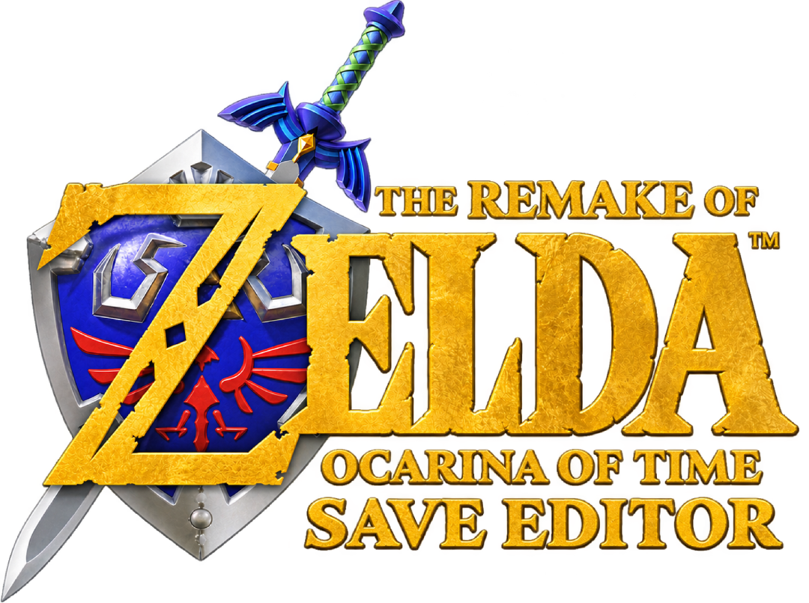
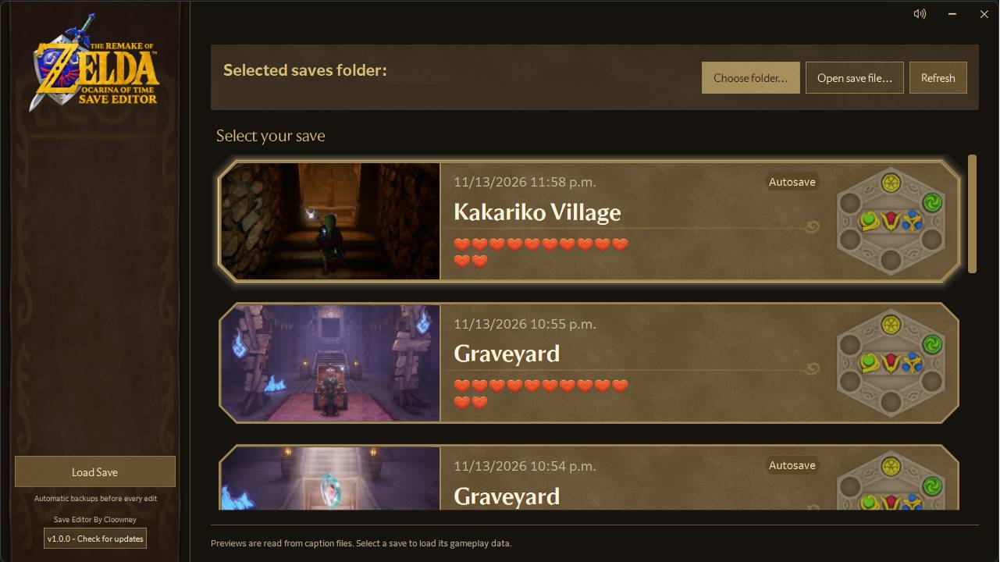
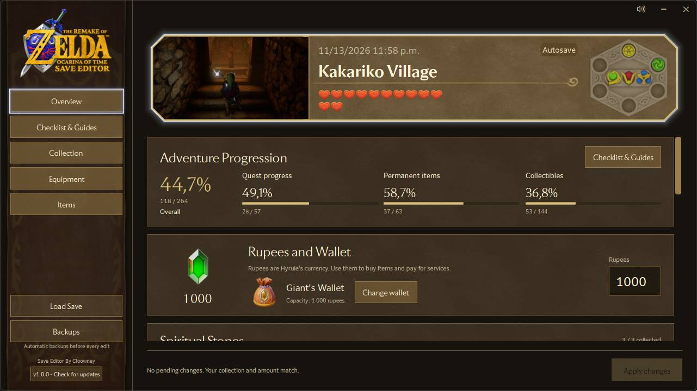
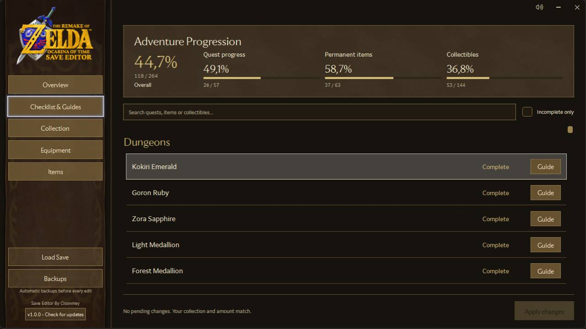
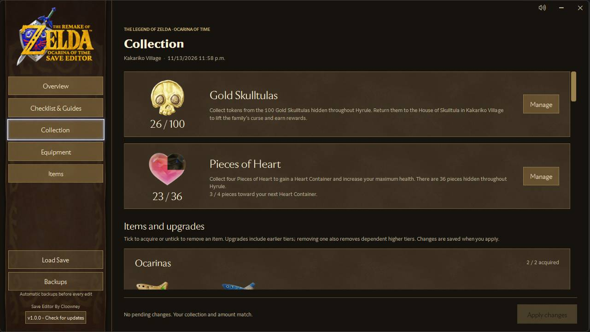
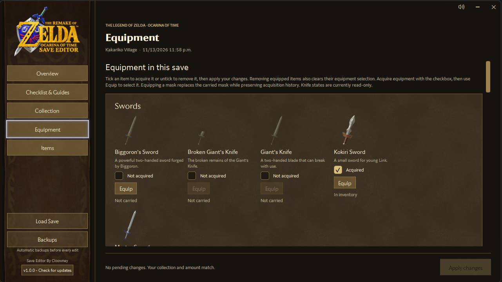
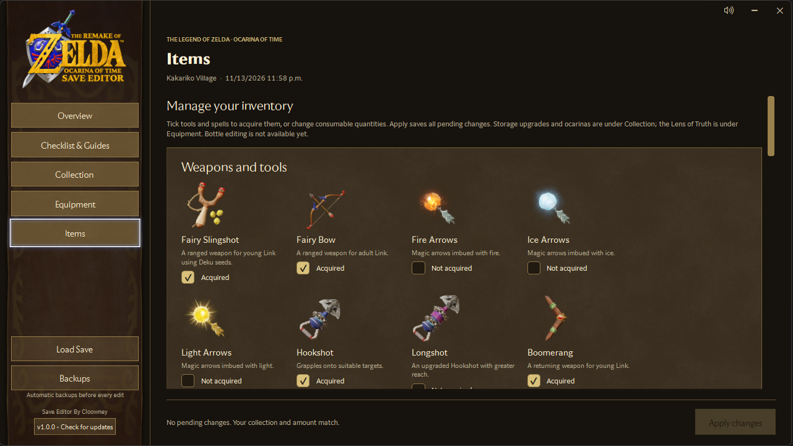

**Edit your adventure. Track your collection. Find what you’re missing.**

A Zelda-themed Windows save editor with equipment and inventory editing, a completion checklist, and in-app guides.

[**Download the latest release**](https://github.com/Cloowney/ZeldaOOTRemakeSaveEditor/releases/latest) · [All releases](https://github.com/Cloowney/ZeldaOOTRemakeSaveEditor/releases) · [Report an issue](https://github.com/Cloowney/ZeldaOOTRemakeSaveEditor/issues)

## Features

- View overall progress and separate quest, permanent-item, and collectible progress.
- Edit rupees and supported upgrades, equipment, tools, spells, and consumables.
- Manage Gold Skulltula locations and review Pieces of Heart.
- Open guides inside the app, with descriptions and available images or videos.
- Play guide videos in a separate resizable window.
- Back up saves when applying edits and install future updates from GitHub.
- Enjoy a Zelda-themed interface with background music and menu sounds.

## Download and start

1. Open the [latest release](https://github.com/Cloowney/ZeldaOOTRemakeSaveEditor/releases/latest).
2. Download **ZeldaOOTRemakeSaveEditor.exe** to a folder you can write to.
3. Run the EXE and choose your save folder or open a save file.
4. Select a save, make your changes, and click **Apply changes** to write them.

The standalone release is for **64-bit Windows**. It includes the .NET runtime, images, fonts, and audio, so you only need to download the EXE. Guide content requires an internet connection; guide video playback requires Microsoft Edge WebView2 Runtime.

Close the game before applying changes so it does not overwrite your edited save. Keep a separate copy of any save you want to preserve.

## Explore the editor

### Load Save

Find your adventure using save cards with a screenshot, location, and saved date. Choose the folder containing your save slots, refresh the list, or open a save file directly. The editor remembers your selected save folder for the next launch.

### Overview

Get a quick view of the loaded save. The Adventure Progression badge shows overall completion alongside quest, permanent-item, and collectible progress. Check your rupees, currently equipped wallet and capacity, Gold Skulltulas, Pieces of Heart, and dungeon rewards. Shortcuts take you to the relevant management page or the full checklist.

### Checklist & Guides

See which tracked objectives are complete and which are still missing. Search the checklist or show only incomplete objectives. Categories include dungeons, quest milestones, songs, permanent items, and collectibles.

Guide buttons open a popup with a loading indicator, description, and available image or video. Matched collectible guides use individual IGN interactive-map markers. Dungeon rewards open their related dungeon walkthroughs. A **Location** button is available for mapped entries, and the source link opens IGN in your browser.

The completion percentage measures the editor’s tracked objectives. It is not an official in-game completion percentage.

### Collection

Review and change supported permanent upgrades, including wallets, bomb bags, quivers, strength upgrades, and diving scales. Item descriptions explain capacities and abilities. Open the collectible management views to inspect Gold Skulltula locations or review Pieces of Heart.

### Equipment

Manage supported swords, shields, clothing, and masks. Acquisition controls let you add or remove supported equipment, while **Equip** buttons select what Link uses. Availability and restrictions depend on the item and the loaded save.

### Items

Manage supported tools and spells, and adjust consumable quantities within their supported storage limits. Icons, descriptions, and acquisition status help identify each item. Changes stay pending until you apply them.

### Guide popup and video

Read guides inside the editor, with a **Gathered from IGN.com** source link beneath the content. When a guide includes a supported video, it replaces the header image. **Popout Video** opens a separate resizable player window.

Videos have their own volume controls. The editor’s music and menu sounds are temporarily silenced during video playback; the app’s mute setting does not mute guide videos.

<!-- Optional guide popup screenshot can be added here. -->

## Backups and preferences

Applying supported save edits creates backups. Use **Backups** in the editor to open the backup location. To restore a backup, close the game and editor, then copy the appropriate backed-up save files into their original slot.

| Data | Location |
| --- | --- |
| Preferences | `%LOCALAPPDATA%\ZeldaOOTRemakeSaveEditor\config.json` |
| Save backups | `%LOCALAPPDATA%\ZeldaOOTRemakeSaveEditor\Backups` |

The sound button at the top right mutes background music and menu effects. Your mute preference is remembered between launches.

## Updates

The editor checks GitHub for newer stable releases after startup. You can also use **Check for updates** in the sidebar. When an update is available, choose whether to download and install it. Download progress appears on the splash screen, then the app replaces its EXE and restarts. The normal unsaved-changes confirmation still applies.

## Compatibility and current limits

This editor supports the remake save format investigated for this project. It is not intended for original Nintendo 64 ROM saves or every other Ocarina of Time port. Other game builds may use different save layouts.

## Testing and bug reports

You may encounter bugs, incorrect values, or unexpected behavior. The editor force automatic backups on for that reason.

If you find a problem, please [report it in GitHub Issues](https://github.com/Cloowney/ZeldaOOTRemakeSaveEditor/issues). Include the editor version, what you were trying to do, what happened, and the steps to reproduce it. Screenshots and the exact error message are helpful too. Your reports help improve the editor for everyone.

## Credits
Guide content is gathered on demand from [IGN’s Ocarina of Time Remake guides](https://www.ign.com/wikis/ocarina-of-time-remake) and interactive maps. Each guide popup includes a link to its source. IGN is not affiliated with this editor.

This is an unofficial fan project and is not affiliated with or endorsed by Nintendo.
